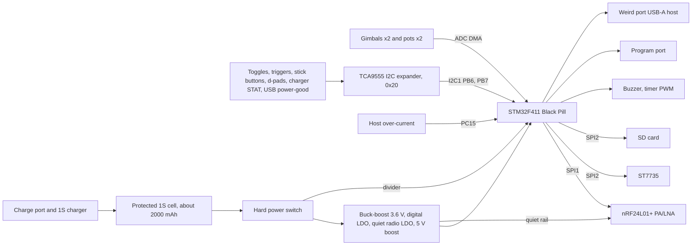
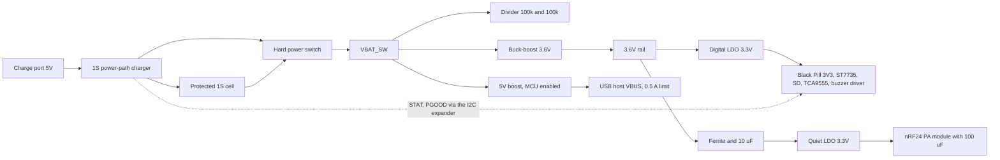

# Hardware and firmware runtime (v5)

Part of [design.md](design.md). Byte-level material is in [appendix-byte-level.md](appendix-byte-level.md). Radio protocol: [design-radio-link.md](design-radio-link.md).

## 1. Inputs and outputs

| Group | Items | Signal | Count |
|---|---|---|---|
| Gimbals (2) | per gimbal: x, y, twist-yaw (3 potentiometers) | Analog | 6 axes |
| Stick buttons | one push button at the top of each stick | Digital | 2 |
| Pots, toggles, triggers | 2, 2, 2 | Analog, digital, digital | 2, 2, 2 |
| D-pads | 2 x 4 directions, one each side of the screen, UI only | Digital | 8 |
| Battery sense | divider from the cell | Analog | 1 |
| Outputs | nRF24L01+ PA/LNA, ST7735 160x128 landscape, SD card (no card-detect line), buzzer | SPI, SPI, SPI, PWM | |
| Ports | program port, weird port (USB host) | | |

**DECIDED (OQ-28):** each gimbal has three analog axes plus one digital button; no fourth analog axis. Analog total is **9** (6 axes, 2 pots, battery); digital total is 14. **DECIDED (OQ-06):** the trainer/PPM port is dropped (out of scope). Telemetry travels over the radio. If a trainer port is ever revived, the FlySky PPM frame, polarity, voltage and pin numbers are all unchecked [verify]. The transmitter has no PWM outputs; servo pulses come from the receiver.

## 2. MCU: STM32F411 Black Pill

**DECIDED (OQ-01):** STM32F411 Black Pill (you own one). It has 100 MHz, 512 KB flash, 128 KB RAM (all DMA-capable, no CCM), a hardware USB OTG FS core, SPI1 to 5, TIM1 to 5 and TIM9 to 11, no hardware RNG, and a 48-pin package that exposes about 32 GPIO [verify against the WeAct board schematic and RM0383]. Alternatives (G4: no USB host; H7: overkill; ESP32-S3: noisy ADC and a 2.4 GHz radio beside the PA; RP2040: too few ADC pins) were rejected. The F4 family has a Renode model but that route is dropped.

The small package forces choices. Design decisions: (1) the nRF24 sits on SPI1 remapped to PB3/PB4/PB5 so that PA0 to PA7 stay ADC pins; (2) LCD and SD share SPI2 (PB13 to PB15) with separate chip selects; (3) **DECIDED (OQ-02, OQ-21): one TCA9555 I2C input expander** (U404, TSSOP-24, address 0x20 with A0 to A2 tied low, no reset pin) on I2C1 (PB6 SCL, PB7 SDA, AF4, 4.7 kohm pull-ups, 400 kHz) reads the 14 controls plus the charger STAT and USB power-good lines on its 16 inputs; the host over-current line (HOST_OC) goes to PC15. This replaces the three 74HC165 shift registers of the earlier plan and also the MCP23017 you asked for first: on the MCP23017, GPA7 and GPB7 are output-only [checked: Microchip DS20001952], which leaves 14 usable inputs for 17 signals, and the three GPIO freed by dropping the shift registers cannot all be I2C pins. The TCA9555 (or the pin-compatible PCA9555) has 16 true inputs. There is **no interrupt line**: the control tick polls the expander without blocking (section 7). **SD card-detect is removed** (the SD interface on the display module has no detect pin); the firmware finds the card by a mount attempt and polling, and the top bar shows an SD icon for mounted or not mounted. (4) There is **no spare GPIO** (PC14, PC15 and PB1 now carry NRF_CE, HOST_OC and NRF_IRQ), so any new pin-hungry feature needs another expander on the same I2C bus (addresses 0x21 to 0x27 are free).

| Pin(s) | Function | Note |
|---|---|---|
| PA0 to PA5 | 6 gimbal axes, ADC1_IN0 to IN5 | PA0 is the board's KEY button; leave it unpopulated or desolder [verify] |
| PA6, PA7 | Pot 1, pot 2, ADC1_IN6, IN7 | |
| PB0 | Battery sense, ADC1_IN8 | |
| PA8 | Buzzer, TIM1_CH1 | |
| PA9, PA10 | USART1 program UART | ROM bootloader pins [verify AN2606] |
| PA11, PA12 | USB D-, D+ (OTG FS, host) | Shared with the Black Pill USB-C connector, see section 3 |
| PA13, PA14 | SWD | |
| PA15, PB3, PB4, PB5 | nRF24 CSN, SPI1 SCK, MISO, MOSI (AF5) | PA15 and PB3 to PB5 are free because JTAG is off [verify AF map] |
| PB6, PB7 | I2C1 SCL, SDA (AF4) to the TCA9555 at 0x20 | 4.7 kohm pull-ups to 3V3, 400 kHz; the only I2C1 pair not used by SPI1 [verify AF map] |
| PB8 | LCD backlight, TIM4_CH3 | |
| PB9, PB10, PB12, PC13 | SD CS, LCD DC, LCD CS, LCD reset | PC13 also drives the board LED |
| PB13, PB14, PB15 | SPI2 SCK, MISO, MOSI (LCD and SD) | |
| PC14 | nRF24 CE (static output) | PC14 and PC15 are low-drive pins (2 MHz, a few mA), enough for a CE line [verify]. The Black Pill boards normally carry a 32.768 kHz crystal on PC14 and PC15 [verify on your board]. We never enable the low-speed crystal (the watchdog uses the internal LSI), so for a static CE output and a pulled-up input the crystal is harmless; remove it only if you see odd CE or HOST_OC behaviour |
| PC15 | Host over-current input (HOST_OC) | 10 kohm pull-up on the inputs sheet; EXTI15 is available but the tick polls it |
| PB1 | nRF24 IRQ (EXTI1) | PB1 is also ADC1_IN9, unused |
| PB2 | Host VBUS enable | PB2 is BOOT1 and must read low at boot: keep a pull-down, which also keeps VBUS off |

**Re-pin for I2C (round 3).** Removing the shift registers freed PC14, PC15 and PB1, but none of them has an I2C function, and every I2C-capable pin was taken (I2C1: SCL PB6 or PB8, SDA PB7 or PB9; I2C2: SCL PB10, SDA PB3 or PB9; I2C3: SCL PA8, SDA PB4 or PB8 [verify against DS10314]). The nRF24 CE and IRQ therefore moved from PB6 and PB7 to PC14 and PB1, and I2C1 took PB6 and PB7. CE is a static line, and IRQ works on any EXTI line (EXTI1 instead of EXTI7), so the move costs nothing in function. The schematic and this table agree.

The final assignment is confirmed in CubeMX in Phase 0 [verify every row]. Timers: TIM1 buzzer, TIM4 backlight, TIM5 control tick (32-bit). DMA: ADC1 on DMA2 stream 0, SPI1 on DMA2 streams 2 and 3, SPI2 on DMA1 streams 3 and 4, I2C1 RX on DMA1 stream 0 and TX on stream 6 [verify the request table].

## 3. Ports

**Weird port (USB-A host).** One OTG FS core is host or device, never both, and the Black Pill USB-C connector is wired to the same PA11/PA12 pins as a device port. The USB-A socket is therefore wired to those pins in forced host mode, with 5 V from a switched, current-limited boost; the Black Pill USB-C connector is used inside the case for bench power or DFU only, and the two must never be connected at the same time. How the Black Pill USB-C VBUS reaches its 5 V rail and onboard regulator, and whether it can back-feed our 3.3 V rail, is unchecked [verify the schematic; remove or isolate the board's VBUS path if needed]. Per-device drivers are in [design-ui-profiles.md](design-ui-profiles.md) section 3.6.

**Program port, DECIDED (OQ-03).** Two ways in. (1) A UART port (J201) on the ROM bootloader (USART1, PA9/PA10 [verify AN2606]) with BOOT0 and NRST, flashed with `stm32flash` or STM32CubeProgrammer [verify versions]; a USB-serial adapter with DTR to BOOT0 and RTS to NRST gives one-command flashing. (2) A **5-pin SWD header (J202): GND, SWCLK, SWDIO, 3V3 sense, NRST**, for an ST-Link, because programming over the Black Pill USB-C has not worked for you. The 3V3 pin is **sense only**: it connects to the +3V3 rail through a 1 kohm series resistor (R203) so the ST-Link can read the target voltage (its sense input is high impedance [verify]). It never powers the board and cannot back-feed the rails, so you can flash while the board runs from the battery or while it is off with the battery switch open, and the laptop is never loaded by the board. With the board off the sense pin reads 0 V, and some ST-Link software then refuses to connect; use connect-under-reset or disable the voltage check [verify]. NRST lets the ST-Link reset the MCU. **Never connect an ST-Link 3V3 output wire to this header or to the Black Pill's own P3 header** (U1 pad 41 is the board's 3V3 net); power the board from the battery or the charge port. The receiver follows the same rule: its programming adapter (USB-serial or ISP) must not feed 5 V into a pack-powered receiver; unplug the pack while the Nano is connected over USB, or put a Schottky diode in the BEC output [verify]. Optional later (Phase 5d): firmware update from the SD card with a 16 KB bootloader (appendix A6).

**Black Pill 3V3 and USB-C power (finding, OQ-38).** In our schematic U1 pads 20, 38 and 41 (3V3) are all on the +3V3 net from the digital LDO U104, and pads 18 and 40 (5V) are unconnected. On the Black Pill the 5V pins connect directly to the USB-C VBUS pin and the 3V3 pin is the output of the board's own regulator [verify the WeAct schematic], so with USB-C plugged while U104 is on, two 3.3 V regulators drive one rail. Findings: (1) with USB-C unplugged, which is the normal case, U104 is the only source; the onboard regulator's input floats and at worst leaks a little, so measure the quiescent current once [verify]. (2) With USB-C plugged and the battery path on, an LDO cannot sink current, so the regulator with the higher output wins and the load split is undefined; damage is not expected but the state is unsupported. **Policy: the Black Pill USB-C stays unused while the battery path is on**; it is for the bench with the battery switch off, and never together with the weird port. (3) A series diode or ideal-diode IC between U104 and the 3V3 pins is not added: it would not stop the other regulator from contending and would cost 0.3 V (Schottky) or another part. Optional hardening: remove the board's regulator or its input path [verify the board]. (4) The radio rail `+3V3_RF` (U105 fed through ferrite FB101, with C112 and C301 to C304 at the module) is separate from `+3V3` (U104) and is never connected to the Black Pill 3V3 pins, which satisfies OQ-38 option (b). No schematic change was needed for this finding.

## 4. Analog and battery measurement

**DECIDED (OQ-29).** Potentiometers are fed from the same filtered 3.3 V as VDDA so reference error cancels (ratiometric). Per input: 100 ohm plus 100 nF at the pin, 12-bit ADC in DMA scan mode, 16x oversampling, median of 3, slew limit. VREFINT corrects the battery reading. The Black Pill's VDDA is tied to its 3.3 V rail, probably through a ferrite [verify]; Phase 0 measures ADC noise on the board and adds a filtered feed if the noise is too high.

Battery sense: 100k/100k divider **after the hard power switch** (nothing drains when off), 100 nF, ADC on PB0 (values in appendix A8). The reading is ignored while USB power-good is set (the rail then sits at the charger output), and a charging icon replaces the percent. Percent is per cell with a 1 s average and a lookup table, clamped to 100 % at or above 4.20 V; the measured voltage can also be shown on screen (setting "Show battery voltage", see [design-ui-profiles.md](design-ui-profiles.md) section 3.7); warning at 3.3 V per cell and 15 %, red alarm below 5 %, protection cut-off about 3.0 V.

**DECIDED (OQ-36): the battery scale is a one-time factory calibration.** `battery_cal_q15` lives in a protected `FactoryRecord` in the flash key-value store (appendix A5), two copies with sequence numbers, copied forward on compaction, never touched by reset, import or profile code, writable only through an unlock token from a hidden menu (Settings, About, hold left and right d-pad Down for 3 s). The factory step applies a known voltage, types it in millivolts, and presses A on the confirm dialog to apply; the scale must land in 0.9 to 1.1 or the screen says "Check divider". Without a record the scale is 1.0 and the battery icon shows "?"; nothing is blocked. Stick calibration stays user-redoable; the first-time stick wizard may also be run at the factory.

## 5. Power (1S)

**DECIDED (OQ-07, cell count): 1S Li-ion/LiPo.** **DECIDED (OQ-07): a protected 1S cell bank of about 2000 mAh** (runtime about 21 h, see the budget below). **You supply your own cell and protection board; the design treats them as a generic protected 1S cell** (4.2 V full, about 3.0 V protection cut-off). A USB gamepad can pull about 0.7 to 0.8 A from the cell [verify], so pick a cell and protection that allow at least 1.5 A. The 2S option from v4 is removed.

**Answer to your regulator question.** Neither the LM2596 nor the AMS1117 fits a 1S cell. The LM2596 is buck-only, needs at least 4.5 V in, runs at 150 kHz with 5 to 10 mA quiescent, and is noisy for a PA [checked: TI datasheet]. The AMS1117 has 1.1 to 1.3 V dropout, so it cannot make 3.3 V from 4.2 V down to 3.0 V, and it wants a 22 uF tantalum [checked]. The Black Pill carries its own onboard 3.3 V regulator; feed the board's 3V3 pin from our digital LDO instead and do not use its 5V path in the case [verify the board's regulator and diode arrangement].

**DECIDED (OQ-38), option (b):** a buck-boost pre-regulator to a 3.6 V intermediate rail (TPS63000 or TPS63020, forced PWM, power-save off), then two 3.3 V LDOs: a digital one and a low-noise one for the radio (TPS7A20 or LP5907), so PA current bursts never share a rail with the ADC reference, and the MCU never shares the radio rail (the radio LDO has its own ferrite and bulk capacitor at the module) [checked datasheets; [verify] LDO PSRR at megahertz and TPS63000 ripple near the 3.6 V crossover]. The 5 V host rail is a TPS63060 buck-boost enabled by the MCU.

Current budget (estimates, [verify] against the chosen parts): MCU at 100 MHz about 30 mA typical and 45 peak; ST7735 with backlight 25 and 45; SD 2 and 100; TCA9555, I2C pull-ups and pot resistors 4 and 6; buzzer 0 and 30; nRF24 PA module about 13 average (8.4 % TX at about 115 mA plus RX at about 45 mA) and 130 peak. Rail total about **74 mA typical, 356 mA peak**. From the cell (buck-boost 90 %): about 80 mA typical, so about 21 h on a 2000 mAh bank (2000 x 0.9 / 80 mA is 22.5 h, rounded down for margin) [estimate]. A gamepad adds about 160 mA (100 mA at 5 V) to about 795 mA (500 mA at 5 V) at the cell [verify the pad's draw], so the cell and protection must handle about 1.2 A peak. Size the pre-regulator for at least 600 mA at 3.6 V.

Capacitors and layout: nRF24 supply pins get 100 nF, 1 uF and 10 uF ceramic (X5R/X7R rated 10 V or more) close to the module, plus a 100 uF low-ESR polymer or tantalum within about 10 mm (130 mA x 50 us = 6.5 uC droops 100 uF by about 65 mV). Radio LDO: 10 uF plus 1 uF in, 10 uF out. Keep the switcher loop, inductor and 5 V boost away from the antenna feed, the radio and the gimbal traces; one ground plane. **Phase 0 gate (kept):** radio-rail ripple under TX below 50 mV peak-to-peak and no droop below 3.1 V [verify module minimum]. Power switch: hard switch between cell and regulators. Protection (over-discharge, over-current, short) is mandatory.

**DECIDED (OQ-24):** you handle the enclosure and mechanical design. The module's own antenna is used, and the hard power switch between the cell and the regulators stays. (The schematic still carries an SMA bulkhead J301 and a U.FL jumper J302 from the earlier recommendation; they are left as they are until you decide whether to keep them.)

## 6. Receiver (Nano class)

**DECIDED (OQ-40):** Arduino Nano class (ATmega328P, 5 V, 16 MHz); a 3.3 V Pro Mini is the alternative. The nRF24L01+ inputs tolerate 5 V while its VDD is 2.7 to 3.3 V, so no level shifter; its MISO and IRQ high level has no guaranteed margin against the ATmega's input-high level, so measure it (appendix A10). The radio gets its own 3.3 V LDO (MIC5219) because the Nano 3V3 pin is too weak for a PA module. Eight servo outputs come from the Servo library on Timer1 (0.5 us ticks, 1000 to 2000 us clamp, 50 Hz frame); no pulses until the first valid packet; failsafe after 500 ms. EEPROM holds bind trio, failsafe values and voltage scale (appendix A4). Pin map: appendix A10. The receiver schematic is in `hardware/receiver/` (single sheet, ERC clean).

**DECIDED (OQ-05):** 10 channels in the packet, 8 servo outputs, CH9 and CH10 as on/off digital outputs on A4 and A5 (high above 0 with 10 % hysteresis), because the default map puts the two toggles on CH9 and CH10. Alternatives: ignore CH9 and CH10, or an 8-channel packet (saves no bytes). The Bind screen shows "8 outputs" from `rx_caps`. The receiver firmware is generic: a board-capability layer (pin map, servo output count, sense divider, cell range) selects the target, so a board with 10 PWM outputs needs no change to the shared code.

**Receiver power and voltage sense (DECIDED, OQ-27, OQ-37).** The receiver monitors the **battery pack that feeds it**, 2S to 4S (16.8 V maximum). A **5 V buck BEC** sits between the pack and the Nano, because a Nano's onboard regulator must not be fed from 4S; the BEC must accept at least 20 V in with margin for transients and supply the Nano, the radio LDO and the servo rail you choose [verify the part]. The receiver reports voltage **only if a divider is fitted**. The divider is taken from the pack **before** the BEC: **100 kohm over 6.2 kohm** on A0 against the internal 1.1 V reference (1.0 to 1.2 V across parts [checked]). The ratio is 0.0584, so 16.8 V gives 0.981 V, which stays under the lowest allowed reference (1.0 V); a ratio of 1/16 would clip on a part with a 1.0 V reference. Resolution is about 18 mV per count. The source impedance is about 5.8 kohm, so a 100 nF capacitor at the pin keeps the reading stable [verify], and the divider draws about 160 uA from a full 4S pack. The one-time scale (OQ-37) absorbs the reference and resistor tolerance. **Cell count is auto-detected at power-up** as `n = ceil(pack_mv / 4250)` and must give at least 2.5 V per cell, else the pack counts as too low. The 3S and 4S ranges overlap (a 3S pack is 9.0 to 12.6 V, a 4S pack 12.0 to 16.8 V), so the detector takes the **lowest count whose per-cell voltage does not exceed 4.25 V**, and a 4S pack below about 12.75 V (under 3.2 V per cell, already nearly empty) reads as 3S. A user override `cell_count_override` (2, 3 or 4) in receiver EEPROM, set from the transmitter's receiver screen, removes the ambiguity; a 4S user should set it. The **low-voltage warning is 3.3 V per cell** (your choice), sent as the `low voltage` flag together with the pack voltage in millivolts. The calibrate command and its safety rules are in [design-radio-link.md](design-radio-link.md) section 7.

## 7. Firmware runtime

**DECIDED (OQ-21): bare-metal, interrupt-driven, no RTOS.** The nRF24 has its own bus (SPI1), so a full-screen LCD refresh (40,960 bytes; at 10.5 MHz about 31 ms, at 21 MHz about 16 ms if the panel accepts it [verify]) never delays a radio transaction. LCD and SD share SPI2 behind one lock. Refresh runs in 16-row strips.

| Priority | Context | Does | Must never |
|---|---|---|---|
| 1 | nRF24 IRQ (EXTI1) and SPI1 DMA complete | Advance the non-blocking nRF24 state machine (`Idle`, `WritingPayload`, `WaitingForIrq`, `ReadingAck`) | Block or call FatFs |
| 2 | TIM5 tick (10 ms), ADC DMA complete | Pend PendSV; flip the ADC half buffer | Do other work |
| 3 | **PendSV control tick** | Swap `Settings` if a commit is pending; consume the last I2C expander read and start the next, read HOST_OC on PC15, read ADC; debounce; run pipeline; build and start the packet; feed IWDG; supervise UI heartbeat | Wait on SD, LCD, USB or flash; allocate; exceed 150 us |
| 6, 7, 8 | USB OTG, SPI2 DMA, SysTick | Stack work, completion flags, 1 ms counter | |
| thread | Main loop | UI, animations, FatFs, USB host task, tone queue, KV store | Hold SPI1 |

SD, USB and LCD drawing never run in PendSV, so a 300 ms SD write cannot delay the tick. The UI never edits what the tick reads: `Settings` lives in two static buffers; the UI fills the inactive one, sets `pending`, and the tick swaps with one atomic store at the start of the next tick. Button events (20 ms debounce, repeat after 400 ms then every 100 ms; there are no long-press actions except the power-on boot combinations) go through a 32-entry single-producer ring to the UI.

**Input expander polling (DECIDED, OQ-02).** Every tick the control tick starts one non-blocking read of the TCA9555 input registers (command 0x00, two data bytes, I2C1 with DMA, about 125 us on the wire at 400 kHz, so it is never waited for) and the next tick consumes the result, so a control change reaches the pipeline one tick (10 ms) later. A control state must read the same on two consecutive samples (20 ms) to count. A transfer that is not finished within 2 ms is aborted, the bus is cleared (up to 9 SCL pulses and a STOP) and the previous state is kept; after 3 consecutive failures buttons read as released, toggles and triggers keep their last value, the top bar shows "INPUT BUS FAULT", `i2c_fault` counts in System telemetry, and the radio keeps transmitting. A good read clears the fault. No interrupt line is used, and the tick never blocks on the bus. The first valid read completes before the first packet is built.

**Radio fault policy.** A fault is three consecutive ticks with STATUS 0x00 or 0xFF, or the state machine forced to `Idle` with no `TX_DS` or `MAX_RT`. A lost packet (`MAX_RT`) is not a fault. Recovery: CE low, power down 5 ms, reload every register, flush FIFOs, read back `RF_SETUP` and `CONFIG`. After the third bad tick the TX dot goes red, the critical alarm sounds and the screen shows "RADIO FAULT". Retry every 100 ms, then every second after 10 failures; success returns to green with a short tone. Tested with a fake `IRadio`.

**Watchdog.** IWDG 100 ms nominal, fed only by the tick; the LSI tolerance is wide so the real timeout is about 70 to 190 ms [verify]. If the main loop heartbeat stalls for 2 s, the supervisor stores a magic value in no-init RAM and resets deliberately.

**DECIDED (OQ-32), option (b): resume in flight.** After an IWDG, brown-out or UI-hang reset the transmitter resumes transmitting at once (gap about 235 ms against the 500 ms failsafe), using a CRC-guarded two-slot mirror of `Settings` in no-init RAM, and stops resuming after 3 resets in 10 s. Power-on, NRST and user reboots are normal starts: they run the startup checks and then transmit as soon as core init is done, with no mute (design-radio-link.md section 6). Flag order, mirror rules and the outage budget are in appendix A7 [verify the F4 reset flags]. Pass level at the bench: packet gap at most 300 ms at the receiver (Phase 1), and from Phase 2 the receiver failsafe flag never sets.

**Build (DECIDED, OQ-22).** C++17 without exceptions or RTTI, CMake with arm-none-eabi-gcc, STM32 HAL/LL, FatFs, a small JSON library, TinyUSB host, GoogleTest on the host, SDL2 for the GUI emulator, a small custom widget layer (not LVGL), `-ffp-contract=off` on host builds. Integer maths only on the hot path.
