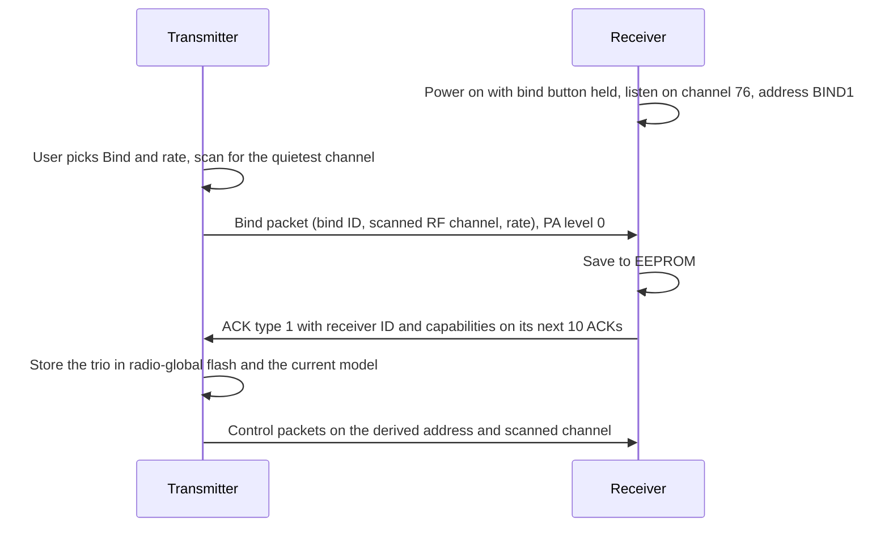

# Radio link (v5)

Part of [design.md](design.md). Exact packet bytes, register values and address vectors are in [appendix-byte-level.md](appendix-byte-level.md) (A1 to A3). Receiver hardware is in [design-hardware.md](design-hardware.md) section 6.

## 1. Overview

**DECIDED (OQ-10):** the radio stays an nRF24L01+ with PA/LNA. ELRS and Crossfire are ruled out. The `RadioLink` interface (`send(ChannelFrame)`, `poll()` for telemetry, `status()`) stays as plain good design so a different chip could be added later without touching the core; no work is planned for that. The nRF24 backend owns all radio policy (fault counting, retries, `seq_echo` checks), so the shared code can be host-tested.

## 2. Link settings and packet

**DECIDED (OQ-08, OQ-34): four radio profiles (section 3).** The baseline (Safe profile) is: 250 kbps (best sensitivity, about -94 dBm against about -85 dBm at 1 Mbps [verify]), 100 Hz or 50 Hz as a **bind-time property** (carried in the bind packet and stored with the bind ID), auto-ack on, ARD 750 us and ARC 0 (stale control data is worse than a lost packet; `MAX_RT` is the "lost" signal), dynamic payload with ACK payload, 16-bit CRC, RF channels 0 to 80. Register values for the profiles: appendix A2. The profile choice also sets the data rate, ARC, CRC length and address width that the receiver must match; the ones the receiver needs travel in the bind packet (appendix A1, byte 10). 250 kbps exists only on the nRF24L01+: at boot the driver writes `RF_DR_LOW` and reads it back, and a failed readback shows "Radio chip unsupported" and a red TX dot. That catches the original nRF24L01 but not every clone, so range-test your module.

The control packet is 17 bytes: type and flags, sequence, 10 channels at 11 bits, and a CRC-8 check keyed by the bind ID. Receiver telemetry rides in a 6-byte ACK payload: receiver voltage in millivolts (0xFFFF means no sensor), link quality, flags (failsafe, low voltage, sense fitted, sense calibrated), and the echoed sequence number. Capability flags travel both in the bind acknowledge (so the Bind screen can describe the receiver) and in every telemetry payload (so the transmitter always follows the receiver it is actually talking to). The telemetry the transmitter sees is about one packet (10 ms) old. Layouts: appendix A1.

Airtime is about 1.6 ms of each 10 ms slot [verify on hardware]. Expected range is 300 to 800 m line-of-sight at head height (about 118 dB link budget, minus 20 to 30 dB for ground reflection, body shadowing and Wi-Fi noise); vendor claims of 1 km or more are best case. **Phase 1 target:** at least 300 m with under 2 % packet loss at the receiver, recorded as the baseline.

**IRQ pin (DECIDED, OQ-39): use it on both ends, with polling as fallback.** It is active low and asserts on `RX_DR`, `TX_DS` and `MAX_RT` [checked]; an ACK with payload sets `TX_DS` and `RX_DR` together, so the transmitter masks `RX_DR`. On the transmitter, PB1 (EXTI1) ends the wait for the ACK without SPI polling, gives exact link statistics and lets the MCU sleep. On the receiver, D2 (INT0) timestamps each packet so the 500 ms failsafe timer runs from arrival time. If no IRQ arrives within 3 ms of the CE pulse, the transmitter reads STATUS once, completes the cycle normally if a flag is set, and counts `irq_missing`; a build flag swaps the EXTI for a 200 us poll timer on bring-up boards, and the receiver polls STATUS every 2 ms if INT0 is silent.

## 3. Radio profiles and power control

**DECIDED (OQ-08, OQ-34): four radio profiles, chosen per model on SetRadio.** This is not legal advice. Radiated power limits depend on your country, the module and the antenna, and you are responsible for staying within them; all limit figures below are unchecked [verify]. The earlier regional power cap and region setting are removed.

| Profile | Settings | Intended use |
|---|---|---|
| **Safe** (default) | 250 kbps, ARC 0, PA level 0 or 1 only | The baseline for a standard (non-PA/LNA) nRF24 module and a safe starting point for any module |
| **Medium** | 250 kbps, ARC 0, the stored Medium PA level of the selected module type | Pushes the module toward the EU 20 dBm EIRP limit without passing it |
| **Extreme** | 250 kbps, ARC 0, PA level 3 (absolute maximum power) | Maximum range. **Needs an explicit opt-in** and can exceed legal limits |
| **Custom** | You edit: PA level, data rate, retry count (ARC) and delay (ARD), RF channel, address width, CRC length, hop table | Experiments and special cases |

**Module type and the Medium level.** EIRP is conducted power plus antenna gain, and a PA/LNA module adds about 20 dB over the bare chip [verify], so one PA level means different power on different modules. A radio-global setting **module type** (standard or PA/LNA, on SetModule) selects a stored Medium PA level for each type. The values come from the module datasheets and are confirmed by measurement: until measured, the provisional values are level 3 for a standard module (about 0 dBm at the chip, far below the limit) and level 2 for a PA/LNA module [verify against the module datasheet]. **Phase 1 task:** measure conducted dBm at each of the four PA levels (power meter or analyser with attenuator) for your module, store the table (`power_dbm[4]`) with the antenna gain, and set the Medium level to the highest one whose EIRP is at or under 20 dBm. The `power_measured` flag shows whether the table is measured; Medium on an unmeasured PA/LNA module is limited to level 1 and says "Power not measured".

**Extreme warning.** Selecting Extreme opens a full-screen warning: "EXTREME POWER. This can exceed the legal power limit where you fly and can disturb other users. You are responsible. A accept, B cancel." The profile changes only after A. The confirmation is stored (`extreme_ack`) so the profile survives a reset-resume and a normal reboot, and Home shows a red "EXT" marker while Extreme is active. Choosing any other profile clears `extreme_ack`, so selecting Extreme again always shows the warning.

**Custom limits.** PA level 0 to 3; data rate 250 kbps, 1 Mbps or 2 Mbps; ARC 0 to 15; ARD 250 to 4000 us in 250 us steps (250 kbps with an ACK payload needs at least 750 us [checked], and the editor refuses lower values at that rate); RF channel 0 to 80 (channels above 83 leave the ISM band) or "from bind scan"; address width 3, 4 or 5 bytes; CRC length 1 or 2 bytes; hop table of 16 channels, used only once hopping exists (Phase 5c). Data rate, address width and CRC length reach the receiver through the bind packet (appendix A1); ARC, ARD and PA level are transmitter-only. A Custom profile that changes them needs a new bind.

**Duty cycle and adaptivity (EU) [verify].** ETSI EN 300 328 limits 2.4 GHz wideband data to 20 dBm EIRP, adds adaptivity rules, and limits the duty cycle of non-adaptive equipment to about 10 %. Our duty is 0.84 ms per 10 ms, **8.4 % at 100 Hz** (4.2 % at 50 Hz), so any packet-rate increase above 100 Hz needs a re-check. In the US a fixed-channel nRF24 does not qualify under FCC 47 CFR 15.247 (it needs a 500 kHz 6 dB bandwidth or hopping over at least 15 channels) and would fall under 15.249 (about 1 mW EIRP) [verify], so outside the EU stay on Safe level 0 unless you have checked your rules.

`effective_power = profile PA level` (Safe is clamped to 0 or 1; Medium uses the stored level for the module type; Extreme is 3; Custom is as set). RF channels stay at 0 to 80.

## 4. Binding

**DECIDED (OQ-26): binding is implemented after the transmitter works with a receiver; Phase 1 uses the fixed development constants below.**



The bind rendezvous is channel 76, address `BIND1`, PA level 0, 30 s timeout on both sides. The transmitter repeats the bind packet every 10 ms for up to 5 s; with no reply the screen shows "No receiver found" and the old ID is kept, and the new ID is stored only after the reply arrives. The operating address is derived from the bind ID by a function in one shared header (`common/protocol.h`, FNV-1a with rejection rules, known-answer vectors in appendix A3); the RF channel is not derived but comes from the scan. The scan samples the nRF24 RPD bit (valid 170 us after RX start [checked]) 64 times per channel with a 200 us dwell, skips channels 74 to 78, and picks the lowest hit count; it is indicative only. Entropy for the ID mixes the 96-bit device UID, ADC noise, the cycle counter at the key press and the previous ID; the F411 has no hardware RNG, and the same function runs on every part.

**The bind trio.** The bind ID, RF channel and rate only work together, so they are always read and written as one unit, in radio-global flash (`last_bind_id`, `last_rf_channel`, `last_rate_code`) and in the current user model (`bind` object). The effective trio is the model's if present, else the global one. Switching between two models bound to two receivers therefore reprograms address, channel and rate together. DEFAULT has no bind and uses the global trio, so a boot with no SD card still reaches your receiver. An invalid model trio falls back to the global one with a warning; with neither, the radio does not transmit and Home shows "NOT BOUND". Until binding exists (it is built after the transmitter works with a receiver), Phase 1 uses compile-time DEV constants instead of binding (`bind_id` 0xDEADBEEF, channel 40, 100 Hz, address `B0 46 5D 4A 69`).

## 5. Failsafe

**DECIDED (OQ-11):** after 500 ms without a valid packet the receiver applies a per-channel mode: stored preset, hold last, or no pulse. Until the first failsafe packet is stored, the factory failsafe is **no pulse on all channels**; the receiver cannot know which channel is throttle, so it never guesses (the transmitter has no designated throttle channel either). After boot there is no output until the first valid packet. Valid packets resume output at once.

"Send failsafe" (a message that programs the receiver's safe values; it stays in the design as long as it never interferes with the transmitter's core function; one-time setup, a Phase 2 exit item): allowed only when the link is green and the values on screen equal the saved model (there is no throttle channel to check, so the on-screen confirmation is the safeguard). The transmitter sends 10 type 2 packets (100 ms; the receiver holds its last outputs), the receiver stores the block and answers `ack_type` 2 with its CRC-8 for the next 10 ACKs, and the transmitter waits up to 1 s for a match, repeating up to 3 attempts, then shows "Failsafe set" or "Failsafe not confirmed". Transmitter low battery sounds an alarm and sets a flag bit; it never silently stops transmitting.

## 6. Hopping and link semantics

**DEFERRED (OQ-09): the root cause of the earlier hopping failure is unknown** (the earlier code was AI-generated and not reviewed). The seven root-cause questions are in open-questions.md and no answers are assumed. Plan: ship a fixed channel in Phases 1 to 4 and design table hopping as a Phase 5c upgrade behind `RadioLink`, so a bad scheme cannot affect the core. Options: A fixed channel from the bind scan (Phase 1); B re-scan on loss; C table hopping (recommended for 5c).

Rules for option C. The hop-table index carried in each packet (`hop_idx`) is the single source of truth for the RF channel; `seq` only counts losses. (1) Both sides derive the same 16-entry table (distinct channels in 0 to 80, at least 2 MHz apart) from the bind ID. (2) The transmitter sends on `table[hop_idx]` and then advances; the receiver switches to the next entry after each valid packet and keeps stepping on a local 10 ms timer after a miss. (3) After 5 consecutive misses the transmitter enters **SYNC-SWEEP**: it sets the `sweep` bit and dwells 16 packets per table entry; the receiver enters SEARCH after 5 misses, dwells 40 ms per entry, and stays put when it hears a sweep packet. The transmitter leaves sweep on the first valid ACK. (4) On entering SEARCH the receiver flushes its ACK FIFO, and the transmitter ignores any `seq_echo` not among the last 3 sent. (5) Allow about 130 us PLL settling [verify]. (6) `hop_enabled` is reserved (0) in the frozen layout. (7) **Required before any hardware test:** a host simulation of both state machines under random loss (0, 10, 30, 50 % plus bursts of 20) must resynchronise within 400 packets at 30 % loss and 600 at 50 % in 10,000 trials, and must fail against a deliberately broken variant that follows `seq`.

**Link and safety semantics (DECIDED, OQ-25).**

| Indicator | Meaning |
|---|---|
| TX dot | Green after the 250 kbps readback passes and no radio fault is active. Red for an unsupported chip or a fault (three bad ticks) |
| RX dot | Green: `ack_type` 0 with `seq_echo` among the last 3 sent within 500 ms. Amber: hardware ACK but no valid telemetry for 500 ms (receiver MCU dead or stale). Red: no ACK for 500 ms. Grey: muted |

Reply types 1, 2 and 3 neither reset nor extend the 500 ms telemetry timer. Status is never colour only: dots also differ in shape.

**Startup and mute (DECIDED, OQ-25).** The radio does **not** start muted. It wakes up ready: as soon as core init is done and a bound model is loaded (the splash and the UI start in parallel and never delay it), it transmits, and it stays on until you mute it from the main menu ("TX off"). There is no designated throttle channel and no boot throttle lockout. Calibration is the first-run step and is done with the radio muted: opening the Calibration wizard mutes the radio, and it resumes when the wizard closes. Calibration validity: `min < centre < max` on centring axes, span at least 1500 of 4095 counts, at least 400 counts each side of the centre on centring axes, checksum valid; otherwise the screen shows "UNCALIBRATED" and the axis uses nominal values, and transmission continues (the warning stays on Home until you calibrate). A model change mutes the radio while the new model loads and resumes it when the checks finish. An in-flight resume after a reset skips these steps (design-hardware.md section 7). Other proposed safety features (muted start, boot throttle lockout, a confirm step before transmitting uncalibrated data) are deferred to [design-future-features.md](design-future-features.md).

## 7. Receiver commands and one-shot voltage calibration

**DECIDED (OQ-37):** the receiver reports the voltage of the pack that feeds it (2S to 4S, up to 16.8 V, divider before the BEC; design-hardware.md section 6) only if a divider is fitted, and its scale is calibrated once, deliberately. The `rx_alarm_mv` setting is per cell (default 3300 mV, 0 turns the alarm off) and the receiver multiplies it by the detected cell count. `sense_state` in receiver EEPROM is 0 not fitted, 1 fitted not calibrated, 2 fitted and calibrated. The transmitter hides the readout in state 0, greys it with "~" in state 1, and shows it normally in state 2; the `rx_alarm_mv` alarm only acts in state 2.

```mermaid
sequenceDiagram
  participant U as User
  participant T as Transmitter
  participant R as Receiver
  U->>T: Settings, Receiver, Calibrate voltage; types the measured millivolts
  T->>T: Check link green, battery not critical
  T->>R: Command arm (nonce, ref_mv, bind ID), sent 3 times
  R->>T: ACK type 3 armed, with the uncalibrated reading
  U->>T: Press A on the confirm dialog
  T->>R: Command apply, same nonce
  R->>R: Compute scale, range check, write EEPROM, read back
  R->>T: ACK type 3 applied, new scale
```

Receiver rules: accepted only while bound (the packet carries the full bind ID); only with a healthy link (3 consecutive valid control packets, failsafe inactive); apply needs a matching arm within 10 s (one pending arm); the reference (the measured pack voltage) must be 5000 to 17000 mV and the computed scale 0.80 to 1.25, else status 2 and no write; at most one apply per 5 s; a command changes only sense state and scale. If the receiver reports no sensor, the screen warns "Receiver reports no sensor. Continue only if you fitted the divider." Computation and status codes: appendix A1 and A4.

Tests (host, with a fake receiver): arm then apply works; apply without arm, wrong nonce, apply after 10 s, out-of-range reference or scale, wrong bind ID, and two applies within 5 s all fail; an interrupted EEPROM write keeps the previous block; a power cycle after success reports state 2 and the same scale.
