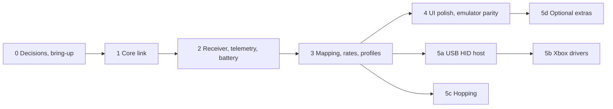

# Roadmap, testing, emulator and risks (v5)

Part of [design.md](design.md). Open decisions are tracked in [open-questions.md](open-questions.md).

## 1. Phased roadmap

Phases 4 and 5 (5a to 5d) run in parallel once Phase 3 is done; they touch different modules. All OQs are now decided (OQ-09 is decided as deferred to Phase 5c), so none blocks a phase; the Entry column records which decisions each phase relies on. The mixer is out of scope and has no phase (see [design-future-features.md](design-future-features.md)). **Freeze rule:** the packet format and the `Settings` layout freeze at Phase 1 exit with later-gated fields already present at their defaults (appendix A5); a later change bumps the schema and protocol version with a migration. OQ-30 and OQ-31 (decided) fix the layout and packet mapping before Phase 1 exit; OQ-19 (decided) is built in Phase 1 as the key-value store.

| Phase | Scope | Entry (blocking OQs) | Exit |
|---|---|---|---|
| **0 Decisions and bring-up** | Resolve Phase 0 OQs; Black Pill dev setup, repo and CMake skeleton, HAL interfaces, host test harness; pin map confirmed in CubeMX (I2C1 on PB6/PB7, PC14 and PC15 usable as GPIO, 32.768 kHz crystal on PC14/PC15 removed or confirmed absent [verify]); TCA9555 read at 400 kHz with an injected stuck-bus test; radio-rail ripple and ADC noise measurements; Nano logic-level check; Black Pill USB-C and 3V3 check (unplugged quiescent current, no USB-C use with the battery on) [verify] | none | Phase 0 OQs (02, 07, 21, 22, 24, 38) are decided; blink, UART log, SWD flash through the 5-pin header with the battery on, nRF24 register read with the 250 kbps readback, ST7735 text in both rotations, SD mounts (mount attempt, no card-detect), expander inputs read; radio rail under 50 mV peak-to-peak (gate kept); host build and CI pass |
| **1 Core link** | All inputs scanned and calibrated; 100 Hz packets on a fixed channel; built-in DEFAULT map; text screen with channel values and TX dot; buzzer beeps; onboard calibration with the minimal key-value store; display rotation at init and boot combo; radio starts at power-up without a mute; watchdog and reset policy; IRQ-driven nRF24 state machine; the four radio profiles and the power table; bare Nano receiver with DEV constants. **GUI emulator skeleton runs in parallel** | Phase 0 exit; decided: OQ-05, 08, 14, 16, 19, 23, 25, 29, 30, 31, 32, 33, 34, 35 | Each control moves the right channel; the radio transmits within about 1 s of power-up and keeps transmitting until muted; 100 Hz stable for 30 min; range baseline (target 300 m); unplugging screen or SD does not affect TX; resume gap at most 300 ms; power table filled; display flips blind; **packet format and `Settings` freeze** |
| **2 Receiver, telemetry, battery** | Nano receiver with 8 servo outputs (and CH9/CH10 digital outputs per OQ-05), failsafe, bind with capability flags, ACK telemetry, voltage only if the divider is fitted, receiver calibrate command, battery divider and percent, factory record and hidden Factory screen, top bar | Phase 1 exit; OQ-11, 15, 26, 27 | Servos track smoothly; failsafe at 500 ms; resume test leaves failsafe unset; battery and receiver voltage within 2 % of a meter after calibration; no divider means no readout; RX dot verified against a dead receiver MCU; bind survives power cycles and two models; boot without SD still binds; failsafe block confirmed |
| **3 Mapping, rates, profiles** | Pipeline stage policy; map, reverse, trim (per-side scaling), rates/expo with the live-input curve preview, endpoints; menus with the OQ-16 button map; DEFAULT; JSON profiles with 50 slots, atomic writes, schema versioning; Import from SD; safe mode | Phase 2 exit; OQ-12, 13, 18 | Stage tests pass; save and reload reproduces channel output exactly (host equals ARM); pulling the SD card leaves TX unaffected; corrupt file falls back to DEFAULT; bad map refuses the profile |
| **4 UI polish and emulator parity** | Theme, widgets, transitions, mascot placeholders and sprite playback, GIF converter, tunes; emulator shows every screen | Phase 3 exit; OQ-14 (full), 17 | Emulator and hardware show the same screens; animation never causes a missed tick (measured) |
| **5a USB HID host** | TinyUSB host spike on the F411, `UsbInputDriver` and registry, `GenericHidDriver`, DualShock and DualSense quirks, per-device calibration, unplug safety | Phase 3 exit | A HID pad drives a servo through the full pipeline; hot-unplug applies the failsafe preset; unknown device listed as unsupported |
| **5b Xbox drivers** | `Xbox360WiredDriver`, then a time-boxed `XboxOneGipDriver` spike | Phase 5a exit | Xbox 360 pad uses the canonical layout; a failed GIP spike is dropped without affecting anything else |
| **5c Hopping** | Table hopping and sweep behind `RadioLink`, after the OQ-09 root-cause review | Phase 3 exit; OQ-09 (decided: deferred here) | Hopping beats a fixed channel in a noisy-band test, or stays off by default; reacquisition time recorded |
| **5d Optional extras** | SD firmware update with a 16 KB bootloader | Phase 4 exit; OQ-03 option d | Independent, removable without touching the core |

The numbers (30 min, 2 %, 500 ms, 300 m, 50 mV) are proposed defaults. Three workstreams run in parallel and meet at the HAL interfaces and the `Settings` format: **GUI** (screens, theme, animations, emulator), **Code** (core, radio, features, storage), **Testing**.

## 2. GUI emulator (DECIDED: GUI and UX only)

The emulator is a desktop app (SDL2, 160x128 scaled up) built from the **shared UI and profile code**. You navigate screens with the keyboard as the d-pads, edit settings, save and load profiles from a host folder, and see palette, layout, animations and the screen map before they exist in hardware. It does **not** run the control loop, radio, USB host or ADC, so it makes no claim about timing, RF or analog behaviour. Renode and QEMU are dropped (DECIDED, OQ-43). The Home channel bars show scripted demo values from sliders.

| Emulator provides | Source |
|---|---|
| `IDisplay` | SDL2 texture, honours `display_rotation` |
| UI button events | Keyboard mapped to both d-pads, including the boot combos |
| `IStorage` for profiles and settings | Host directory, with a "remove card" key for missing-SD paths |
| `IBuzzer` | SDL audio square wave |

The emulator and the firmware build from the same source tree in one CI job, which fails if any file under `ui/` or `profiles/` is compiled for only one target, or if `platform/stm32/` pulls in UI headers that are not HAL interfaces. Platform drivers contain no decisions: they convert hardware to HAL types, and everything that decides, validates, formats or parses is shared and host-tested. Panel gamma, offsets and refresh time need the real panel.

## 3. Testing

Testing is mostly manual, as you said, on top of a host unit-test layer.

| Level | What | Tool |
|---|---|---|
| Host unit tests (every commit) | Calibration and curve maths with exact vectors, map validation, trim math vectors (centre, both endpoints, every step of 5), packet pack/unpack for every type and 11-bit value, CRC-8 and address vectors, JSON load and migrate, battery lookup, failsafe packing, bind-trio switching, no-SD boot, USB unplug behaviour and driver report vectors, `decide()` truth table, hop-sync simulation, radio fault policy with a fake `IRadio`, mirror corruption, receiver calibrate rules, factory record isolation, button-map and edit-mode state machine, SavePrompt rules, expander read with injected I2C faults (timeout, stuck bus, 3 failures), radio profile register sets and the Extreme confirmation, MADCTL table, no flash write while TX is active | GoogleTest |
| Golden test | A saved and reloaded profile gives the same channel bytes; host and ARM match | GoogleTest plus an on-target run |
| Fault injection | Corrupt JSON, truncated files, unknown schema, missing SD, bad map | GoogleTest |
| GUI emulator | Navigation, saving, layout, safe mode, display flip, animations | Manual and scripted key sequences |
| Bench checklist (per release) | Below | Manual |

Bench checklist: (1) each axis moves the right channel over its full range; (2) each switch, trigger and d-pad registers once per press; (3) receiver servo moves smoothly; (4) pull the transmitter power: failsafe in about 500 ms and recovery; (5) range walk-away in each antenna orientation; (6) battery within 2 % of a meter at three points after factory calibration; (7) receiver voltage within 2 % after calibration, hidden when no divider; (8) the radio transmits within about 1 s of power-up with no button press and keeps transmitting until you mute it; (9) remove the SD card in operation; (10) each radio profile (Safe, Medium, Extreme with its warning, Custom) programs the nRF24 as specified and Extreme needs the confirmation; (11) buzzer events; (12) USB gamepad hot-plug (5a); (13) force a reset under stick deflection and measure the packet gap at the receiver (at most 300 ms, and from Phase 2 no failsafe flag); (14) a sector erase with TX muted does not reset, and an erase while transmitting is deferred until you mute; (15) boot with no SD still reaches the bound receiver; (16) conducted power per PA level; (17) radio rail ripple below 50 mV and no droop below 3.1 V; (18) unplug the IRQ wire and confirm the polling fallback; (19) display flip at boot and no stray edge line; (20) Nano MISO and IRQ high level at least 3.2 V; (21) USB-C and USB-A weird port wiring on the Black Pill: no back-feed into the 3.3 V rail [verify]; (22) the SWD header 3V3 pin never powers the board (battery off, ST-Link attached: board stays dead, laptop unloaded); (23) receiver cell auto-detect on 2S, 3S and 4S packs and the 3.3 V per cell warning.

## 4. Risks

| # | Risk | L / I | Mitigation |
|---|---|---|---|
| R1 | nRF24 PA unstable from a noisy supply | High / High | Quiet LDO behind a 3.6 V pre-regulator, bulk capacitor, Phase 0 ripple measurement |
| R2 | Hopping unreliable again | Med / Med | OQ-09 root causes, fixed channel first, `hop_idx` in the packet, host simulation before hardware |
| R3 | **Black Pill has no spare GPIO**, or an alternate-function conflict | Med / Med | One I2C expander carries the controls and two status lines (more can share the bus), pin map confirmed in CubeMX, fall back to a larger package if a feature needs pins |
| R4 | Black Pill USB-C shares PA11/PA12 with the weird port, and its VBUS wiring is unchecked [verify] | Med / Med | Policy: Black Pill USB-C unused while the battery path is on, check the schematic in Phase 0, optionally remove the onboard regulator path |
| R5 | ADC noise on the Black Pill's VDDA feed | Med / Low | Phase 0 noise measurement, filtered feed, oversampling and deadband |
| R6 | Display DMA stalls the radio | Low / High | nRF24 on its own SPI bus, strip refresh |
| R7 | Xbox One (GIP) not feasible on the F411 | High / Low | Separate driver behind an interface, spike first |
| R8 | Flash erase stalls the tick (up to about 2 s [verify]) | Med / High | Erase only while muted or before the first packet, deferred in flight, IWDG extended, one sector per operation |
| R9 | Code refactoring debt (ponytail-style cleanup deferred by choice) | Med / Low | Listed in the future-features file; keep modules small and tested meanwhile |
| R10 | Regulatory non-compliance (power above local limits, EU 8.4 % duty) [verify] | Med / Med | Four radio profiles, measured power table, Medium tied to the module type, Extreme behind a warning and opt-in, not legal advice |
| R11 | Battery safety and gamepad current peaks | Low / High | Protected cell rated at least 1.5 A, charger IC, hard cut-off |
| R12 | Clone nRF24 chips differ | Med / Med | 250 kbps readback, range test your module |
| R13 | Resume loop or wrong model on air | Low / High | Two-slot CRC mirror, three-resets-in-10-s guard, bench test |
| R14 | Nano receiver logic-high margin | Med / Med | Own LDO, measure MISO and IRQ, optional HCT buffer, Pro Mini alternative |
| R15 | Upside-down screen | Med / Low | Blind boot combo, stored rotation |
| R16 | Scope creep from animation art | High / Low | Placeholders first |

## 5. Verification status

**Checked** (datasheets, vendor docs, source code): nRF24L01+ 5 V tolerance, DC levels, ARD table, IRQ behaviour, RPD; ATmega328P input levels, speed grades, 1.1 V reference range, EEPROM, INT0; Arduino Servo limits; LM2596, AMS1117 and the TPS and LDO figures; Xbox 360 and One class codes and layouts from Linux `xpad.c`; TinyUSB class folder and `tusb_xinput`; ST7735 MADCTL values from the Adafruit library.

**Unchecked, tagged [verify] in the text:** FlySky PPM details (moot while the trainer port is dropped); STM32F4 and F411 flash sector map, erase times, reset flags, LSI range and OTG forced-host setup; Black Pill schematic details, USB-C VBUS wiring and onboard regulator; F411 AF map for SPI1 on PB3 to PB5; FCC and ETSI limits (for the profile notes); USB gamepad current draw; DualShock and DualSense product ids; TinyUSB dwc2 host on the F411; ST7735 SPI clock limit and BGR bit; module current and ripple; cell capacity and protection rating. Documents to check against: nRF24L01+ Product Specification, RM0383 and the F411 datasheet, AN2606, WeAct Black Pill schematic, ETSI EN 300 328, FCC 47 CFR 15.247 and 15.249, TinyUSB docs, ST7735 datasheet, the datasheets of your gimbals, PA module, charger and regulators.
