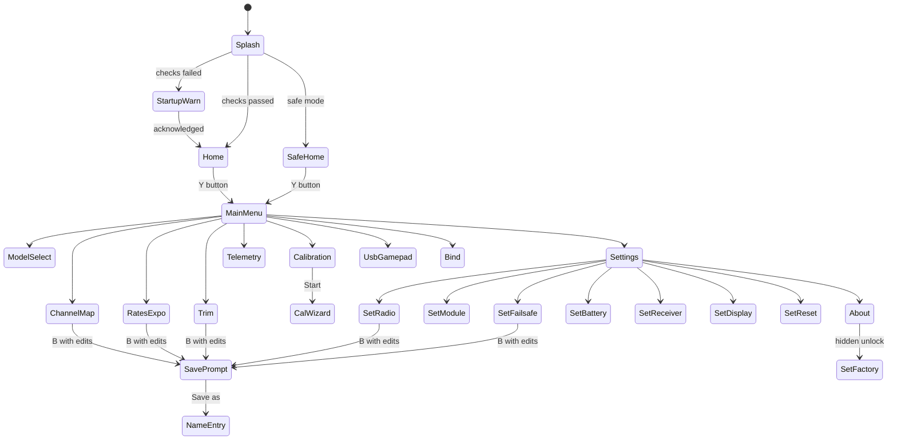

# UI, features and profiles (v5)

Part of [design.md](design.md). Struct layouts are in [appendix-byte-level.md](appendix-byte-level.md) A5 and A9. Hardware: [design-hardware.md](design-hardware.md).

## 1. Signal pipeline


`Signal` is an `int16_t` in permille (-1000 to +1000), integer maths only, truncation toward zero, so host and ARM builds are bit-exact. Stages 3 and 4 are identity-bypassable: a disabled or invalid one passes the value straight through. Stages 5 and 6 are **protected**: they are validated at profile load, a bad map or endpoint config refuses the profile and loads DEFAULT, and they are never skipped at runtime (a skipped map swaps channels, a skipped reverse flips a servo). At 100 Hz no stage can throw, block or allocate, and all validation happens in the UI context at load. A disabled or buggy optional stage therefore never interrupts input to channel to radio, which is your requirement. The pipeline keeps a stage hook between the channel map and reverse/endpoints so a later stage can be added without touching the core; no fields are reserved for one in the layouts (see [design-future-features.md](design-future-features.md)). Worst-case pipeline budget is 100 us. Stages are small interfaces (`InputStage`, `ChannelStage`) registered by the composition root into fixed arrays; features never call each other and see only frames and a read-only `Settings` snapshot.

**Safe-mode boot** (hold left d-pad Down at power-on): rates/expo and trim are bypassed; map, reverse and endpoints stay active. A "SAFE MODE" banner shows (screen `SafeHome`) and an alarm sounds.

**DECIDED (OQ-12): trim after the curve, and trim only moves the centre.** With trim before expo, the curve flattens a centre offset; trimming afterwards shifts the centre by the same amount whatever the expo. Endpoints and curve shape are not affected (math in section 3.2), so the order of operations never changes another stage's result indirectly. This deviates slightly from the order in your notes.

## 2. Input table and default map

| ids | Inputs | Signal |
|---|---|---|
| 0 to 5 | `stick_l_x`, `stick_l_y`, `stick_l_twist`, `stick_r_x`, `stick_r_y`, `stick_r_twist` | calibrated axes |
| 6, 7 | `pot_1`, `pot_2` | calibrated |
| 8, 9 | `toggle_1`, `toggle_2` | down -1000, up +1000 |
| 10 to 13 | `trigger_1`, `trigger_2`, `stick_btn_l`, `stick_btn_r` | released 0, pressed +1000 |
| 16 to 23 | d-pad buttons | UI only, never in the `InputFrame`, never mappable |
| 32 to 63 | `usb_*` | normalised USB gamepad, section 3.6 |

**DECIDED (OQ-33).** Yaw is `stick_l_twist`, as in your notes. Default map: CH1 `stick_r_x` (roll), CH2 `stick_r_y` (pitch), CH3 `stick_l_y` (throttle), CH4 `stick_l_twist` (yaw), CH5 `stick_l_x`, CH6 `stick_r_twist`, CH7 `pot_1`, CH8 `pot_2`, CH9 `toggle_1`, CH10 `toggle_2`. The alternative (mode-2 AETR with yaw on `stick_l_x`) is not used.

## 3. Features

| # | Feature | Phase | Notes |
|---|---|---|---|
| F1 | Inputs to radio to channels | 1 | core, built-in DEFAULT map |
| F2, F3 | Assignable inputs, reverse | 3 | 3.1 |
| F4, F5 | Dual rates and expo, endpoints, trim | 3 | 3.2 |
| F6 | Mixer | dropped | out of scope (OQ-20), 3.3 |
| F7 | Weird port, per-device USB drivers | 5a, 5b | 3.6 |
| F8, F9 | Immutable DEFAULT, about 50 profiles on SD | 3 | section 5 |
| F10, F11, F12 | Battery indicator, TX and RX link dots, receiver voltage | 1 to 2 | 3.7 |
| F13, F14, F15 | Palette, mascot and animations, buzzer (beeps Phase 1, tunes Phase 4) | 1, 4 | section 4 |
| F16, F19 | Stick calibration (onboard then USB), factory battery calibration | 1, 2, 5a | 3.5, hardware 4 |
| F17 | GUI emulator | 1 skeleton, 4 parity | roadmap 2 |
| F20 | Display rotation 0 or 180 | 1 to 3 | 4.6 |

The trainer/PPM port (former F18) is dropped.

**3.1 Channel map and reverse.** A channel has one source input (or none, outputting centre); an input may feed several channels; d-pad ids are rejected. **DECIDED (OQ-30): reverse is per channel (servo reverse)**, owned by stage 6: negate, then apply endpoints. Per-input reverse is not provided.

**3.2 Rates, expo, trim, endpoints (DECIDED, OQ-12, OQ-13, OQ-31).** Per input, axes and pots only (toggles, triggers and buttons ignore these): `rate_hi` and `rate_lo` 0 to 1000 (a switch value above 0 selects `rate_hi`; no switch means `rate_hi`), `expo` -500 to +1000, `trim` -250 to +250 in steps of 5. Per channel: `ep_lo`, `ep_hi` 0 to 1000. Formulas (32-bit integer, truncation toward zero, so host and ARM are bit-exact): `x_r = x * r / 1000`; `x3 = (x_r * x_r / 1000) * x_r / 1000`; `y = ((1000 - e) * x_r + e * x3) / 1000`, the curve output in -1000 to +1000.

**Trim math (OQ-12).** Trim `t` only shifts the centre; the endpoints and the curve shape do not change. It is per-side scaling applied after the curve, not shift-and-clamp, so full travel stays reachable: `y_t = t + y * (1000 - t) / 1000` for `y >= 0`, and `y_t = t + y * (1000 + t) / 1000` for `y < 0`. Then `y = +1000` gives +1000, `y = -1000` gives -1000, and `y = 0` gives `t`. The result stays inside -1000 to +1000 without clamping, and the function is monotonic for |t| up to 250 (slopes `(1000 - t) / 1000` and `(1000 + t) / 1000` are at least 0.75). Worked example, `t = 100`: `y = 0` gives 100; `y = 500` gives 100 + 500 x 900 / 1000 = 550; `y = -500` gives 100 - 500 x 1100 / 1000 = -450; `y = 1000` gives 1000. A host test checks these vectors and the end points for every `t` in steps of 5.

At stage 6 `s_r = reverse ? -s : s`, `out = s_r * ep_(hi or lo) / 1000`; packet `pkt = ((out + 1000) * 2047 + 1000) / 2000`. The curve is monotonic for expo in -500 to 1000. Endpoints apply last so nothing upstream can exceed servo limits. **DECIDED (OQ-31): endpoints limited to 100 %.** Overtravel to 120 % would change the packet mapping and the receiver clamp, so it is not offered (see future features). Calibration deadband (default 20 permille, centring axes only) lives with calibration, not the model.

**Curve preview (OQ-13).** The rates/expo and endpoints editors draw the input curve of the selected input as a graph with a crosshair marking that input's live value: a vertical line at the live input and a dot where it meets the curve, like the FlySky GUI. The graph uses the same curve and trim functions as the pipeline.

**3.3 Mixer.** Out of scope (DECIDED, OQ-20); see [design-future-features.md](design-future-features.md).

**3.4 Switches, triggers, pots** use the same pipeline as sticks; a switch can select the rate set. A three-position switch would add an input type, not change the pipeline.

**3.5 Calibration (F16, DECIDED, OQ-25).** Per axis: `min`, `centre`, `max` and a `centring` flag. Calibration is done with the radio muted: the wizard mutes it when it opens and restores it when it closes. The wizard works like a console gamepad. Release the sticks and press A to capture the centre, then push each axis to both extremes while the live minimum and maximum are shown, and press A to finish and save (B cancels without saving). **The centre step applies only to axes with a spring centre** (the six stick axes by default); pots, toggles and axes marked non-centring (for example a ratchet throttle, set in the wizard) are calibrated by the sweep alone, and their `centre` is the midpoint of `min` and `max`. Normalisation is linear on each side of the centre, clamped to +-1000. **Stick calibration is user-redoable** and stored in the flash key-value store, separate from profiles and from the factory record. USB axes arrive as 12-bit counts and reuse the same module; only the first 8 axes are calibratable; calibrations are kept for up to 4 devices by VID/PID with least-recently-used replacement; an unknown device starts at nominal 0 / 2048 / 4095 and is offered the wizard.

**3.6 Weird port, DECIDED (OQ-04): per-device drivers.** An Xbox pad is not a generic HID device (Xbox 360 uses a vendor class with a fixed 20-byte report; Xbox One uses the GIP protocol), so each family has its own driver behind one `UsbInputDriver` interface (`match`, `attach`, `onReport`, `poll`, `detach`) and a fixed-size `UsbRegistry`. Every driver outputs the same canonical `PadState` (8 axes at 12-bit, 24 buttons, ids 32 to 63; sticks, triggers, face buttons, d-pad as buttons), so maps and curves do not care which driver found the pad. Selection: VID/PID match beats class match, earlier registration breaks ties, a failed `attach` falls back to the generic HID driver, and one pad is active at a time. Scope: `GenericHidDriver` (report-descriptor parsing) first in 5a, `HidQuirkDriver` for DualShock and DualSense in 5a [verify product ids], `Xbox360WiredDriver` in 5b (class 0xFF, subclass 0x5D, protocol 1 [checked: Linux `xpad.c`]), `XboxOneGipDriver` later behind a time-boxed spike that may fail without affecting anything else. Wireless adapters and Bluetooth are out of scope. TinyUSB host has an HID class but no Xbox class; the community `tusb_xinput` driver covers Xbox 360 and One [checked]. Whether TinyUSB's dwc2 host runs well on the F411 is unchecked and is the first Phase 5a task, a one-day spike with a real pad [verify]. The USB-C draw of a gamepad is about 100 mA wired without rumble, up to the 500 mA port limit [verify].

**Unplug safety (decided).** On unplug, enumeration failure or 500 ms without a report, all USB inputs are marked invalid and read as neutral everywhere: a channel whose source is invalid takes its failsafe preset (load-time validation requires failsafe mode `preset` on any channel mapped to a USB input, or the profile is refused); an invalid `rate_switch` reads 0; anything else reads 0.

**3.7 Indicators and buzzer.** Battery (F10): `BatteryState` with percent, volts, charging, low, critical, calibrated. **DECIDED: percent is clamped to 0 to 100; any reading at or above 4.20 V shows 100 %.** **DECIDED: battery voltage readout,** so the user can watch for over-discharge by eye. The measured cell voltage (the same 1 s average that drives the percent, after the factory scale) is shown to two decimals, e.g. `3.87V`. It is controlled by the global setting **Show battery voltage** (SetBattery screen, default on, stored with the other global settings): when on, the voltage appears on the Home screen in the bottom-right of the content area, beside the battery cluster's percent; when off, only the percent shows. The Telemetry System page always shows the voltage regardless of the setting. While USB power is present the readout keeps updating but is suffixed with a charging mark (`4.18V+`), because the charger holds the cell high. Uncalibrated readings get the same "?" marker as the battery icon. Link dots (F11): semantics in design-radio-link.md section 6. Receiver voltage (F12, pack voltage with cell count): hidden if not fitted, greyed with "~" if uncalibrated, greyed when no telemetry for 1 s. Buzzer (**DECIDED, OQ-23: passive piezo** on TIM1 PWM, non-blocking tone queue): beeps in Phase 1, tunes in Phase 4; critical alarms (low battery, link lost) ignore mute.

## 4. UI/UX

### 4.1 Screen map (approved)



**B (back) always returns one level** (first-level screens to MainMenu, Settings sub-screens to Settings, MainMenu to Home); every screen listed above except Home returns up with B, and X saves on an editing screen (section 4.4). Edit classes: **model editing** (ChannelMap, RatesExpo, Trim, SetRadio, SetFailsafe) is dirty against the current slot and saved to SD; **radio-global editing** (SetModule, SetDisplay) commits to RAM at once and to flash at the next mute point ("Saved at next stop"); **self-confirming actions** (Bind, CalWizard, SetReceiver calibrate, SetReset, SetFactory) confirm themselves; the rest are read-only. SavePrompt offers Save, Save as and Discard (default Save; B keeps editing). On DEFAULT, Save is not offered and X goes to NameEntry. Unsaved edits are forgotten at power-off, as in your notes; with no SD card the edits stay live in RAM and "SD missing: not saved" shows. The trainer screen (SetTrainer) is removed with the trainer port. Screen contents:

| Screen | Contents |
|---|---|
| Home | Top bar, model name, ten channel bars (final values), "TX OFF" when muted, a red "EXT" marker while the Extreme profile is active, "UNCALIBRATED" banner when calibration is invalid, "NOT BOUND" if never bound |
| Telemetry | Pages: Link (RX dot, LQI, loss, ACK age, channel, rate, PA); Receiver (voltage state, outputs, flags); System (battery, reset reason, `irq_missing`, `i2c_fault`, version) |
| Bind | Rate choice, scan progress, result with receiver id and capabilities |
| SetRadio (model) / SetModule (global) | Radio profile (Safe, Medium, Extreme with warning, Custom), Custom parameter editor (PA level, data rate, ARC and ARD, RF channel, address width, CRC length, hop table greyed until 5c), receiver alarm per cell, hopping switch (greyed until 5c) / module type (standard or PA/LNA), stored Medium PA level per type, power table and measured flag, Extreme confirmation state |
| SetBattery | Show battery voltage (on/off, default on); low-battery warning and shutdown thresholds; battery calibration status |
| SetFailsafe | Per-channel mode and value; "Send failsafe" enabled only when values equal the saved model |
| SetReset | Reset to defaults; import calibration and radio settings from SD (never touches the factory record) |
| SetDisplay | Brightness, volume, mute, flip display, "Save display settings now (mutes TX)" |
| NameEntry | Characters `A-Z a-z 0-9 space - _`, up to 12 |

Screens by phase: 1 text status, Calibration, StartupWarn, boot flip combo; 2 Home with top bar, Telemetry, Bind, SetBattery, SetReceiver, SetFailsafe, About, SetFactory; 3 MainMenu, ModelSelect, ChannelMap, RatesExpo, Trim, SavePrompt, NameEntry, Settings screens, SafeHome; 4 Splash, animations, full theme; 5a UsbGamepad.

### 4.2 Palette

**DECIDED (OQ-14), option (a).** Black text on a black-filled element is invisible, so: screen background black; idle element black fill, white border, white text; **focused element white fill with black text** (where "black text within elements" applies); disabled dark grey. Theme (RGB565, one table in code): background `0x0000`, border, text and focus `0xFFFF`, accent `0x07FF`, green `0x07E0`, red `0xF800`, amber `0xFD20`, disabled `0x7BEF`; contrast target 4.5:1 or better; status is never colour only. Confirm the colours on the real panel [verify].

### 4.3 Layout and navigation

160x128 px: 14 px top bar, 100 px content, 14 px footer hints, 6x8 font. **DECIDED (OQ-15), top bar:** one left cluster (battery icon, percent, TX dot, RX dot; x 0 to 59), model name of 8 characters (x 64 to 111), receiver volts and the SD icon (x 116 to 159). The SD icon shows mounted or not mounted; there is no card-detect line, so the firmware finds the card by a mount attempt and polling (section 5). Safe mode: left d-pad Down held at power-on. Both d-pads feed one event queue, so navigation code does not know which pad was pressed. Buttons are described in section 4.4.

### 4.4 Button map (DECIDED, OQ-16)

The left d-pad is the cursor and the right d-pad is the action pad in an Xbox layout: bottom is A, right is B, left is X, top is Y. There are no long-press actions; every command is a button press, and only the power-on boot combinations are held.

| Button | Browsing | Editing a field |
|---|---|---|
| Left pad Up / Down | Move the cursor | Value +1 / -1 |
| Left pad Left / Right | Switch tabs (when no field is being edited) | Value -10 / +10 |
| A (right pad bottom) | Accept: open the item, or enter edit mode on a field | Confirm the new value |
| B (right pad right) | Back and cancel: leave one level; with unsaved edits it opens SavePrompt | Revert the field and leave edit mode |
| X (right pad left) | Save (editing screens): validate and write the current slot | not used |
| Y (right pad top) | Options menu of the screen; on Home it opens the main menu | not used |

Up/Down and Left/Right repeat after 400 ms and then every 100 ms while held. **X** validates and writes the current slot atomically and stays on the screen with a "Saved" message (on DEFAULT it opens NameEntry); a protected-stage failure stays on screen with a message. On radio-global screens X commits to RAM and marks a pending flash write (written at the next mute, section 5). On calibration and factory screens A is the confirm step. **B** with no unsaved edits leaves without a prompt; with edits it opens SavePrompt (Up/Down choose Save, Save as or Discard; A confirms; B keeps editing), so edits are never discarded silently. **Y options** are a short list for the screen: on model-editing screens Save as, Discard changes and Reset this screen to defaults; on other screens the actions that make sense there, or "No options". The Home main menu starts with **TX on / TX off** (the user mute of the radio, section 5 of design-radio-link.md). **NameEntry:** left pad Left/Right moves the cursor, Up/Down changes the character, A accepts the name, B cancels. **Boot combinations stay:** left d-pad Down held at power-on is safe mode; left d-pad Up and right d-pad Up held at power-on flips the display (section 4.6). The tick debounces (20 ms) and emits one `ButtonEvent` per press, so the UI needs no long-press state machine.

### 4.5 Mascot and animation (DECIDED, OQ-17)

An **original catgirl-style mascot** (not a copy of the Flipper Zero dolphin or any existing character) plays with its transmitter while something loads and leans or dances in the background on idle screens, as in your notes. Order: (1) code-drawn placeholders first (a rectangle with cat ears and eyes that bobs, a progress bar), so no art is needed to build the UI; (2) later artwork is loaded from the SD card as **16-bit (RGB565) BMP files** (`/ui/*.bmp`, mascot frames in `/ui/mascot/`, a small JSON file for the frame rate), so you can replace the placeholders with your own images; a PC-side tool can convert GIF or PNG frames to BMP; (3) sprites up to 64x64 at 8 to 12 fps streamed from SD, drawing only the changed rectangle; full-screen animation only for the splash, streamed in strips; (4) animation runs only in the UI context, the limiter drops animation frames and never control ticks, and a missing file or SD card falls back to the built-in code-drawn placeholder.

### 4.6 Display rotation (DECIDED, OQ-42)

Radio-global `display_rotation` (0 or 180, landscape), applied at init through MADCTL (appendix A9) with per-variant offsets, changeable live on SetDisplay. The UI draws in logical coordinates and the display driver owns the rotation. Blind recovery: hold left d-pad Up and right d-pad Up (Y) while powering on; the firmware flips, stores immediately (the radio has not started transmitting yet, so the flash write is allowed), and beeps twice. It is ignored on a resume boot, and if more than one boot combination is held none is acted on. D-pad mapping is physical and does not change.

## 5. Profiles and storage

**DECIDED (OQ-18): both.** **DEFAULT** is compiled into flash, read-only; "Reset to defaults" copies it onto the working copy; editing it always asks "Save as". **User slots M01 to M50** are JSON files on the SD card (`/models/m01.json`). The last used slot is stored in internal flash; if its file is missing or invalid DEFAULT loads with "Profile missing, using default". DEFAULT contents: name `DEFAULT`, the default map with no reverse and endpoints 1000, failsafe CH3 preset -1000 (the default map's throttle stick) and every other channel preset 0, neutral curves, radio profile Safe, no bind (uses the global trio). A unit test loads DEFAULT through every validation with zero warnings.

JSON (versioned, permille everywhere, 1-based channels):

```json
{ "schema": 1, "name": "Trainer plane",
  "bind": { "id": "A1B2C3D4", "rf_channel": 40, "rate_hz": 100 },
  "radio": { "profile": "safe", "hop_enabled": false, "rx_alarm_mv": 3300 },
  "channels": [ { "channel": 3, "source": "stick_l_y", "reverse": false, "ep_lo": 1000, "ep_hi": 1000,
                  "failsafe": { "mode": "preset", "value": -1000 } } ],
  "inputs": { "stick_r_x": { "rate_hi": 1000, "rate_lo": 600, "rate_switch": "toggle_1", "expo": 200, "trim": 0 } } }
```

Load validation (UI context): unknown newer `schema` refuses the file and loads DEFAULT; unknown keys are ignored; a missing or out-of-range field takes its DEFAULT value with a warning; protected-stage failures (map, reverse, endpoints, USB-failsafe rule) refuse the profile; expo or trim problems disable just that feature with a warning; `bind` must be complete (8 hex digits, channel 0 to 80, rate 100 or 50) or it is ignored; a `radio.profile` of `extreme` loads as `safe` with a warning until Extreme is confirmed on SetRadio; a `custom` profile carries a `radio.custom` object with the fields of design-radio-link.md section 3; files over 16 KB are rejected; older schemas migrate in memory and are rewritten only on save.

**Where data lives (DECIDED, OQ-19, OQ-35).** Only calibration and radio-global settings use internal flash; profiles (with their trims) go to the SD card. Flash key-value store (authoritative): factory record, stick and USB calibrations, radio-global values (last slot, bind trio, module type, Extreme confirmation, power table, brightness, volume, mute, rotation), mirrored to `/system/*.json` and imported only by the explicit SetReset action. SD: models and `/ui/` assets. A minimal key-value store is built in Phase 1. Layout and sector addresses: appendix A6.

**Write policy (DECIDED, OQ-35).** A sector erase stalls code fetch for about 1 to 2 s on the F411 [verify], longer than the 500 ms failsafe, so internal flash is erased or programmed **only while the radio is muted or has not started transmitting**. "Muted" means: you muted it from the main menu, the radio has not sent its first packet since boot (the display-flip boot write), or an action that mutes it itself (a model switch, Bind, the Calibration wizard, "Save display settings now"). A write needed in flight is **deferred**: the data stays in RAM, the screen shows "Unsaved: mute to save", and the write happens at the next mute point. A model switch mutes the radio, writes `last_slot`, loads, re-runs the startup checks and resumes. Before an erase the IWDG reload is extended to about 4 s. UI settings (brightness, volume, mute, flip) stay in RAM while transmitting and commit at the next mute point. A test asserts that no flash write happens while TX is active.

**SD safety.** Atomic write: `.tmp`, flush and verify, rename old to `.bak`, rename `.tmp`, delete `.bak`; at mount delete stale `.tmp`, restore an orphaned `.bak`, delete a redundant `.bak`. Writes only from the UI context. There is no card-detect line: the UI context tries a mount at boot and every second while unmounted (only when idle), and the top-bar SD icon shows mounted or not mounted; a failed access unmounts the filesystem and edits stay in RAM. A corrupt card shows a message, continues on DEFAULT and never blocks the radio. Mount read-only until an explicit save.
