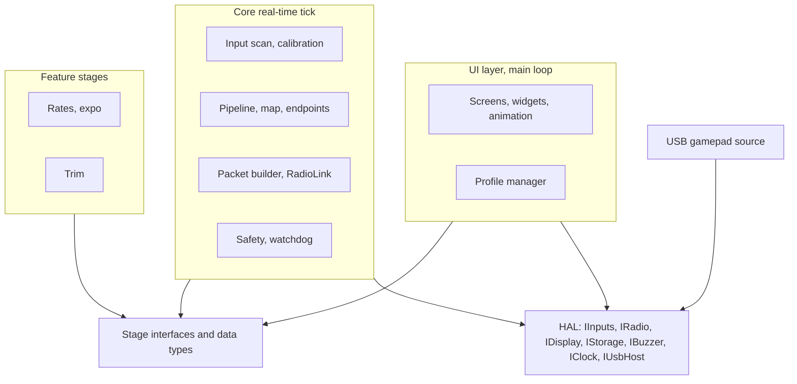

# Custom Multichannel nRF24L01 Transmitter: Design (v5)

Source: your notes in [design-brief.md](design-brief.md) (unchanged) and the decisions in `HANDOVER.md`. Decisions are tracked in [open-questions.md](open-questions.md) (v5); ids like **OQ-xx** point there. **DECIDED** marks your decisions. **OPEN DECISION** marks a choice you have not made. Where a choice is "provisional default, user to confirm", the text uses that default and the question stays open. Unchecked facts are tagged **[verify]**; facts checked against a datasheet or source are tagged **[checked]**.

## Files

| File | Content |
|---|---|
| [design-hardware.md](design-hardware.md) | Inputs, Black Pill pin map, I2C input expander, ports (SWD header), analog and battery, 1S power, receiver (pack monitor, BEC), firmware runtime |
| [design-radio-link.md](design-radio-link.md) | Link settings, IRQ, radio profiles and power control, binding, failsafe, hopping, link semantics, startup, receiver calibration |
| [design-ui-profiles.md](design-ui-profiles.md) | Signal pipeline, input table, features, screen map, palette, button map, mascot, profiles and storage |
| [design-roadmap.md](design-roadmap.md) | Phases 0 to 5, GUI emulator, testing, risks, verification status |
| [appendix-byte-level.md](appendix-byte-level.md) | Packet layouts, address vectors, EEPROM, structs, flash sectors, reset flags |
| [design-future-features.md](design-future-features.md) | Features that were dropped or deferred (mixer, startup safety, regional cap, refactoring and more) |

## v5 change note

Applied from HANDOVER: 1S battery (about 2000 mAh protected cell bank); STM32F411 Black Pill replaces the F405/Nucleo plan; trainer/PPM port dropped; emulator is GUI and UX only and Renode/QEMU are dropped; gimbals are 3 analog axes plus a top button (9 analog inputs, no fourth-axis contingency). The design is condensed from about 2,170 lines into this index and four topic files, and byte-level detail moved to the appendix. Review logs and older changelogs are not carried forward; v4 is in `docs/backup-v4/`.

**Round 3 (your answers to the open questions).** Every open question is now decided. Main changes: one TCA9555 I2C input expander replaces the three 74HC165 shift registers (the MCP23017 you asked for has two output-only pins and cannot carry 17 inputs), SD card-detect is removed, and the nRF24 CE and IRQ moved to PC14 and PB1 to free PB6/PB7 for I2C1; a 5-pin SWD header with a sense-only 3V3 pin; four radio profiles (Safe, Medium, Extreme with a warning, Custom) replace the regional power cap; trim is per-side scaling after the curve; the receiver monitors a 2S to 4S pack through a 5 V BEC with cell auto-detect and a 3.3 V per cell warning; the Xbox-style button map replaces hold-Back-to-save; the radio no longer starts muted and there is no throttle lockout; flash writes wait for a mute; the mixer and Phase 5 are out of scope and dropped, later phases are renumbered (5a to 5d), and the dropped and deferred features are listed in [design-future-features.md](design-future-features.md).

## Overview

You are building a custom RC transmitter around an nRF24L01+ PA/LNA radio. It has two 3-axis gimbals with a button at the top of each stick (pitch and roll, twist-yaw, and a button for another input), two pots, two toggles, two triggers, two d-pads (8 buttons) on each side of the screen, a 1.8 inch ST7735 landscape screen, an SD card for JSON profiles, a buzzer, a program port, and a "weird port" for USB gamepads. A deliberately simple receiver (Arduino Nano class, 5 V logic) outputs servo PWM and, if a divider is fitted, reports its voltage. The transmitter has no PWM outputs; the receiver makes the servo pulses.

Goals in priority order: (1) a reliable core link, inputs to radio to servo; (2) optional features that cannot break the core; (3) a pretty, easy UI with a mascot and animations arriving late through placeholders; (4) a GUI emulator on the desktop built from the shared UI code; (5) a phased path so the GUI, code and testing workstreams run in parallel.

| Practice | How the design honours it |
|---|---|
| DRY | One `Signal` type and one set of curve functions serve hardware and USB inputs; one persistence layer; one `Theme` table |
| KISS | Bare-metal, interrupt-driven tick, fixed arrays, integer maths, no heap in the control path, a small custom UI toolkit |
| SOLID | Pipeline stages are small interfaces; hardware sits behind HAL interfaces; a composition root wires everything |
| A feature must not break another | Features talk only through frames and a read-only `Settings` snapshot; no feature calls another |
| Decoupling (optional stages off, core still works) | Optional stages are identity-bypassable; map and reverse/endpoints are protected and validated at load |
| Core first | Phase 1 is inputs to radio to channels, a text screen and beeps |

The core never imports feature code. `main` is the only place that knows both sides: the firmware links the STM32 HAL and the nRF24 backend; the GUI emulator links a desktop HAL for display, buttons, storage and buzzer only (design-roadmap.md section 2).

## Terminology

An **input** is any physical or USB control value. A **channel** is one numbered output slot in the radio packet (CH1 to CH10 in the UI, 0 to 9 in code); the receiver turns each into a servo pulse. The **bind trio** is bind ID, RF channel and packet rate, always handled as one unit.

## Decisions at a glance

Decided: nRF24 stays (OQ-10), STM32F411 Black Pill (OQ-01), TCA9555 I2C input expander without SD card-detect (OQ-02, OQ-21), 5-pin SWD header with sense-only 3V3 (OQ-03), 10 channels and a generic receiver (OQ-05), 1S cell bank of about 2000 mAh (OQ-07), four radio profiles (OQ-08, OQ-34), hopping root cause deferred to Phase 5c (OQ-09), failsafe message (OQ-11), trim after the curve with per-side scaling (OQ-12), curve preview (OQ-13), palette, top bar, button map, SD assets, profiles, storage (OQ-14 to OQ-19), mixer out of scope (OQ-20), buzzer, enclosure, startup and calibration (OQ-23 to OQ-25), binding later (OQ-26), receiver 2S to 4S pack monitor with BEC (OQ-27), reverse, endpoints, reset policy, input map (OQ-30 to OQ-33), flash-write policy (OQ-35), power architecture (OQ-38), plus the earlier decisions (OQ-04, 06, 10, 28, 36, 37, 39, 40, 42, 43). OQ-41 is superseded by OQ-16. Nothing is open; the remaining [verify] items are facts to check, not decisions. Full list and status: open-questions.md.
